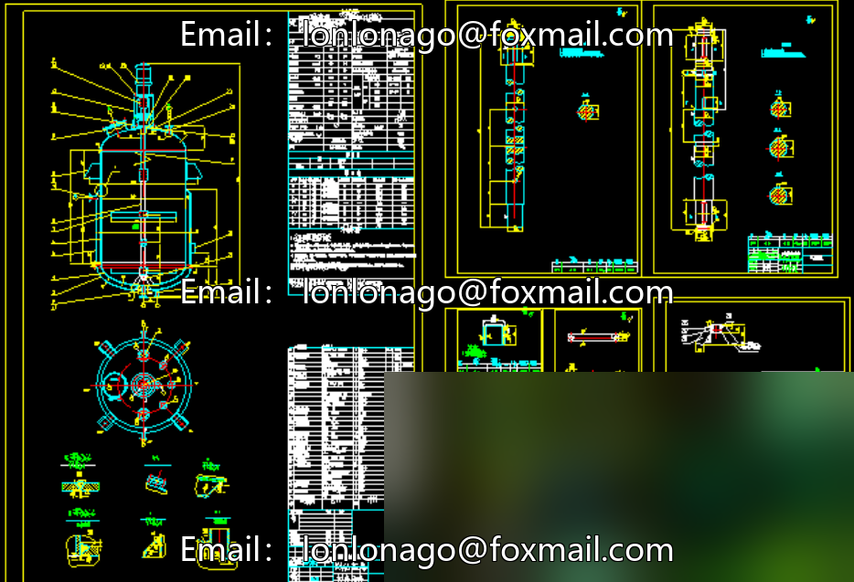
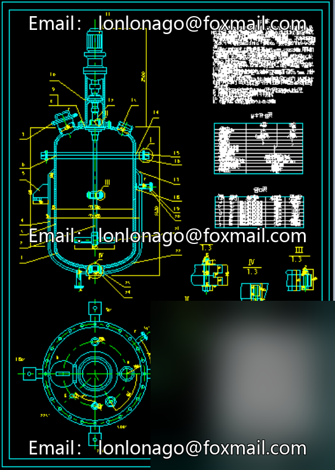

# 511 stir reaction kettle CAD design diagram

## Body

511 CAD design drawings for mixing reaction kettle 511 mixing reaction kettle design 511 mixing reaction kettle CAD drawing 511 mixing reaction kettle design CAD drawing
Paddle-type mixer jacket reaction kettle design 2 paddle-type mixer design drawings
Contains 2 sets of reference CAD drawing data, such as the attached drawings

The content covers CAD design diagrams and related design materials for the 511 stirred reaction furnace, including paddle-type stirrer jacketed reactor design and reference CAD materials.

<!-- AI_ENRICHED -->

## Images

## Payment

Here is a pay link on Stripe ( https://buy.stripe.com/3cs8yP7sY87d0vu9AB ). Please contact me lonlonago@foxmail.com after funding $89, and I will send you a complete data files , thank you!

